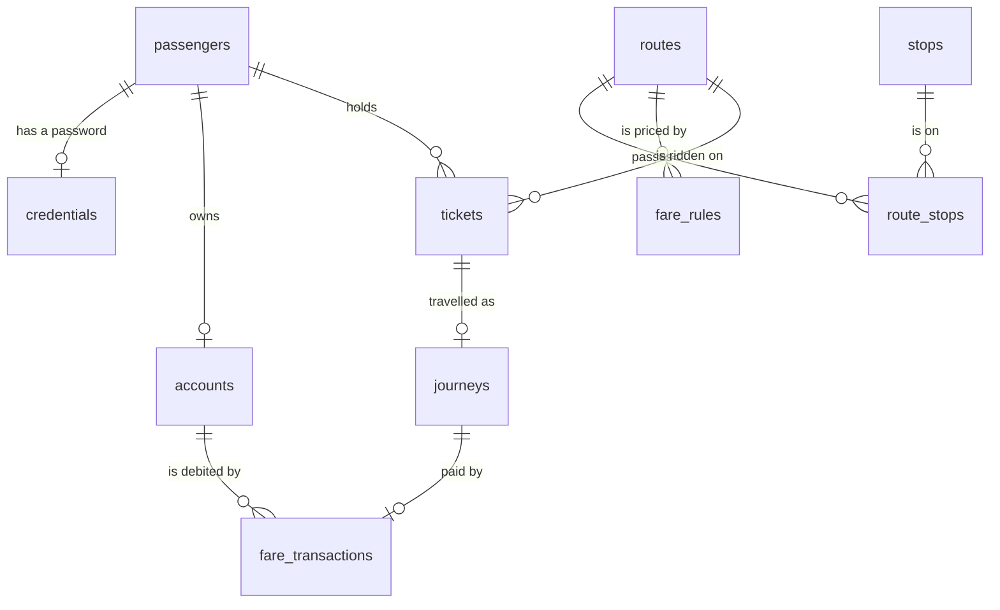

# Journey Execution: design

Alerts are not part of this function (they belong to Monitor Credit Alerts). Going past the planned stop is only a flag on the result.

Sections 1 to 7 describe Journey Execution. Section 8 describes Customer onboarding, which was added later and reuses the same layers. Section 9 describes the SQL database, which replaced memory as the default home of the data without changing a service. Section 10 describes ticket booking. Section 11 describes the console log, which watches all of them without changing any.

## 1. Domain model

Only the classes this sequence touches.

| Class | Holds | Point to notice |
|---|---|---|
| `Passenger` | id, name, email, residency | Opens its own account (`openAccount`): the residency decides which kind (section 7). |
| `Residency` | `Resident`, or `NonResident` with a visa expiry date | Residency, not nationality, decides the account (rule A1). |
| `Account` | id, passenger id, balance in whole rupees | `canPay`, `deduct`, `credit` are final and shared. A `PermanentAccount` never expires; a `TemporaryAccount` is usable through its visa expiry date. There is no `setBalance`. |
| `FareTransaction` | id, reference, account id, journey id, amount, balance after, time | One row per debit. The only link between money and a journey. |
| `QRTicket` | id, QR code, passenger id, route, boarding stop, planned destination, travel date, quoted fare, state | `refusalReason(today)` and `markUsed()`. The state is an object (section 7): Active, Used, Expired, Cancelled. |
| `Journey` | id, ticket id, route, boarding stop, exit stop, tap in, tap out, fare due, fare charged, state | Has the state machine below. Asks its state instead of comparing status names (`isOpen`, `isSettled`, `isAwaitingPayment`). |
| `Stop`, `Route`, `RouteStop` | the network | `Route` owns its stops in order and answers `isBefore` and `distanceKm`, so nothing else needs the stop table to price a trip. Read-only here. |
| `FareRule` | route, type (DISTANCE or FLAT), base fare, rate per km, flat amount, effective from, effective to | Pricing is data with dates, not a field on `Route`. |

Relationships:

- A passenger has one account and many tickets. A resident gets a permanent account, a non-resident a temporary one.
- A ticket has zero or one journey (association, not composition: the ticket exists before the journey and survives it).
- An account has many fare transactions, and each transaction names the journey it paid for. There is no direct Account-to-Journey link.
- A route has many route stops (each pointing at one stop) and many fare rules.

## 2. Journey state machine

| From | Event | To | Side effects |
|---|---|---|---|
| (none) | Board accepted | IN_PROGRESS | Nothing is charged. |
| IN_PROGRESS | Exit scan, credit is enough | COMPLETED | One debit, ticket becomes USED. |
| IN_PROGRESS | Exit scan, credit is short or the account has expired | PAYMENT_PENDING | `fareDue` is set, `fareCharged` stays empty, nothing is debited. |
| PAYMENT_PENDING | Settle (or scan out again), credit is enough | COMPLETED | One debit, ticket USED. |

Any other pair is an illegal transition and must fail loudly.

`fareDue` is what the system says is owed. `fareCharged` is what has actually been debited. They differ exactly while a journey is PAYMENT_PENDING.

## 3. What changed while building

These are the places where the built design differs from the first version of this document.

| First design | Built | Why |
|---|---|---|
| One `Account` class | `Account` with `PermanentAccount` and `TemporaryAccount`, opened by the passenger's residency | Tourists have accounts that stop working on their visa date (rules A1 to A3). |
| An `Alert` class and alert endpoints | Removed | Alerts are a different function. Overtravel stays as a flag on the result. |
| Status values as text and enums | State classes for tickets and journeys | Each rule lives in one class, and a wrong move fails loudly. |
| `FareCalculator` looks up stops and rules itself | It is given the `Route` and the rules | The calculator needs no repository, so it is tested without a database. |
| Boarding only checked the balance | Boarding and exit both ask `Account.canPay` (usable and enough credit) | One definition of "can pay" (rule A4). |
| `POST /api/test-data/tickets` | Removed | Issuing tickets is another function; the demo data already has tickets for every case. |

## 4. The API contract

The whole function is one endpoint, `POST /api/reader/scan`. The others only feed the screen.

| Method and path | Purpose | Needed for |
|---|---|---|
| `POST /api/reader/scan` | A reader scans a ticket: direction IN or OUT, at a stop | The sequence itself |
| `POST /api/journeys/{id}/settle` | Retry payment on a PAYMENT_PENDING journey | Rule D1 |
| `GET /api/reference` | Stops, and routes with their stops in order | The line on the screen |
| `GET /api/passengers`, `/passengers/{id}/account` | Passengers with balances; one account with its transactions | Display |
| `GET /api/tickets`, `/journeys`, `/journeys/{id}` | Lists for the screen | Display |
| `POST /api/test-data/credit`, `/reset` | Stand-in for Top Up; restore the demo data | Demo |
| `POST /api/onboarding/register`, `/login` | Register a customer and open the account; check a login | Customer onboarding (section 8) |
| `POST /api/tickets/quote`, `POST /api/tickets` | Price a trip; book it | Ticket booking (section 10) |
| `GET /api/health` | Is the server up | Smoke check |

Request:

```json
{ "qrCode": "MLK-HAPPY01", "direction": "OUT", "stopId": "S5", "scannedAt": "2026-10-22T08:40:00+05:30" }
```

`scannedAt` is optional and defaults to now. It lets tests and the demo control the clock.

Response (shortened):

```json
{
  "outcome": "JOURNEY_COMPLETED",
  "tone": "SUCCESS",
  "message": "Fare LKR 69 charged. Balance LKR 431.",
  "ticket": { "qrCode": "MLK-HAPPY01", "status": "USED" },
  "journey": {
    "journeyId": 1, "status": "COMPLETED", "fareDue": 69, "fareCharged": 69, "overtravelled": false,
    "trip": { "kind": "AS_TICKETED", "boardedOffTicket": false, "exitedOffTicket": false,
              "quotedFare": 69, "fareDifference": 0, "overcharged": false }
  },
  "fare": { "due": 69, "charged": 69, "balance": 431 },
  "overtravelled": false
}
```

`outcome` is one of JOURNEY_STARTED, JOURNEY_COMPLETED, PAYMENT_PENDING, ALREADY_SETTLED or REJECTED. A rejection (or a payment waiting on an expired account) carries a `reason`. `tone` (SUCCESS, WARNING, ERROR) tells the screen which colour to use, so the browser never interprets business codes.

Status codes:

| Code | When |
|---|---|
| 200 | Any business result, including a refused ticket (`outcome: REJECTED`). A rejection is an answer, not an error. |
| 201 | A customer was registered, or a ticket was booked |
| 400 | Malformed request. Body: `{ "error": "VALIDATION", "message": "...", "details": [...] }`. A registration or a booking with wrong fields lists them all in `details`. |
| 401 | `INVALID_LOGIN`: a wrong password or an unknown email (the same answer for both) |
| 404 | Unknown stop, journey or passenger (a booking for a customer who does not exist too) |
| 409 | Illegal state change, the store refused the data (constraint violation), or `EMAIL_TAKEN` |
| 422 | The account has expired, so it cannot be changed |
| 500 | Bugs only |

## 5. Build order

Built from the inside out, so every layer is tested before the next one exists.

| Phase | Build | Check |
|---|---|---|
| 3a | Passenger, Residency, Account kinds, QRTicket, Journey, dates | Plain unit tests |
| 3b | Network classes, FareRule, fare strategies, FareCalculator | Unit tests using the worked fares in rules.md |
| 3c | Repository interfaces, in-memory store, unit of work, demo data | Rollback and constraint tests |
| 3d | Services and the board, alight, settle workflow | Service tests, no HTTP |
| 3e | JSON, routes, validation, error mapping | HTTP tests against a real server on a free port |
| 4 | The React screen | Used by hand against the running server |

The payoff: when a fare is wrong, I look in `fare`, never in the browser.

## 6. Eight decisions

1. **Money is whole rupees in a `long`.** No `double` for money, ever.
2. **Storage sits behind interfaces.** The in-memory store can be replaced by a database without touching a service. It was: section 9 added the SQL store, and no service, route or screen changed.
3. **Charge on exit, never at boarding.** The boarding balance check is advisory.
4. **A debit is idempotent.** Its reference `FARE-<journeyId>` is unique, so a retried request cannot charge twice.
5. **The server decides, the browser displays.** No fare or validity logic in React.
6. **Rejections are answers.** The reader always gets a message it can show.
7. **One scan, one unit of work.** If anything fails halfway, every change is undone.
8. **Dates are Colombo dates.** Rules receive the scan time as a parameter, so tests control the clock.

## 7. Design patterns

| Pattern | Where | Why it fits | Phase |
|---|---|---|---|
| **State** | `TicketState` with Active, Used, Expired, Cancelled; `JourneyState` with InProgress, PaymentPending, Completed | Behaviour depends on status and the status changes over time. Each rule lives in one class, and illegal moves fail loudly. | 3a |
| **Template Method** | `Account`: `canPay`, `deduct` and `credit` are final; each kind only decides `isUsableAt` | The steps are fixed, so no kind can skip the expiry check. | 3a |
| **Factory Method** | `Residency.openAccount`, called by `Passenger.openAccount` | The passenger never decides which kind of account to build; its residency does. | 3a |
| **Information Expert** | `Account` owns its balance (no setter); `Route` owns its stops and distances; `QRTicket` decides its own refusal | The object with the data makes the decision. | 3a, 3b |
| **Strategy** | `FareStrategy` with `DistanceFareStrategy` and `FlatFareStrategy`, chosen by `FareCalculator` from the `FareRule` type | The fare algorithm is chosen from outside by data and never changes during a calculation. | 3b |
| **Repository** | `repository` interfaces; `repository.memory` and `repository.jdbc` implementations | Services do not know how data is stored (decision 2). | 3c, 9 |
| **Unit of Work** | `UnitOfWork`; `InMemoryDatabase` and `JdbcDatabase` | The writes of one scan succeed together or not at all (rule D5). In SQL it is one database transaction. | 3c, 9 |
| **Exception translation** | `DomainException` carries a code and an HTTP status; `NotFoundException`, `ConstraintViolationException` extend it; `ApiServer` turns them into responses | Services know nothing about HTTP. | 3e |
| **Service layer, Facade** | `JourneyService` for the workflow, `ReaderService` as the single entry for the reader screen | One place per workflow. The web layer calls one object. | 3d |
| **Static factory** | `Journey.start`, `FareRule.distance/flat`, `FareTransaction.forJourney`, `TicketCheck.ok/refused` | Names say what is being made; a refused ticket is an answer, not an exception (decision 6). | 3a to 3d |
| **Builder** | `ScanResult.Builder` | A scan result has many optional parts. | 3d |
| **Composition root** | `Container` | The only place that wires services to a store. `App` chooses which store. | 3e, 9 |
| **Abstract Factory** | `Store` with `InMemoryStore` and `JdbcStore` | One object hands out a matching set (the unit of work and every repository), so a repository can never be paired with a unit of work from another store. | 9 |
| **Simple factory** | `OnboardingRequest.residency()` | The request turns "RESIDENT" or "NON_RESIDENT" plus a date into the right `Residency` object once, so no caller writes `if (resident)`. | 8 |
| **Facade** | `OnboardingService` (the "AuthSystem" in the sequence diagram) | The web layer calls `register` and `login` and knows nothing about hashing, ids or accounts. | 8 |
| **Decorator** | `LoggedUnitOfWork` over the store's `UnitOfWork` | Same interface, so no service can tell. It adds a line at begin, commit and rollback, and changes nothing else. | 11 |
| **Proxy** | `RepositoryTrace.wrap(...)`, a JDK dynamic proxy over each repository interface | One class traces all eight repositories with no hand-written copy of any of them. It stands in for the real repository, writes a line after each call and passes the call on. | 11 |
| **Immutable value object** | `PasswordHash`, `OnboardingRequest` | A hash cannot be changed after it is made; a request is checked, never edited. | 8 |

State and Strategy look the same in UML (an interface plus implementations) but differ in intent. In Strategy the caller picks the algorithm and it does not change. In State the object changes its own behaviour as events happen, and each state decides the next one.

## 8. Customer onboarding

This is the "New user - Registration" and "Existing user - Login" part of the Top Up Credit sequence diagram. The rest of Top Up Credit (choosing an amount, paying, adding the credit) is another function. `POST /api/test-data/credit` still stands in for it.

### The sequence, message by message

| Message in the diagram | Where it is in the code |
|---|---|
| `register(name, email, password)` | `POST /api/onboarding/register`, then `OnboardingService.register` |
| `createUser(name, email, password)` | `PassengerRepository.insert` and `CredentialRepository.insert`. The password is hashed first. |
| `createAccount(userId, initialCredit = 0)` | `AccountRepository.insert(passenger.openAccount(0))`. The residency decides the kind (rules A1, O3). |
| `registrationSuccess(userId)` | `AuthResult`: the user id, one sentence to show, and the customer |
| `login(credentials)`, `validateCredentials` | `POST /api/onboarding/login`, then `OnboardingService.login` |
| `loginSuccess(userId)` | `AuthResult` |
| `loginFailed()` | `DomainException` with code `INVALID_LOGIN`, HTTP 401 |

### What registration does

1. The request is checked by `OnboardingRequest.problems(today)`. Every wrong field is collected, and if there are any, nothing is created (rules O1, O3).
2. The password is hashed with PBKDF2 (rule O6). This is slow on purpose, so it is done before the lock is taken and never holds up other requests.
3. One unit of work (rule O5) checks the email is free (O2), inserts the passenger, inserts the password hash and inserts a permanent or temporary account with LKR 0 (O3, O4). If any step fails, all are undone, including the ids that were handed out.
4. The answer is built from the same `QueryService` the passenger list uses, so the new customer is in the list at once (O9). The screen reloads the lists after registering, so the new customer is there when they log in. The sign-up screen itself has no list.

### Data added

| Item | Detail |
|---|---|
| `credentials` table | passenger id to password hash. Kept apart from `Passenger`, so a passenger is never accidentally sent anywhere with a hash attached. One row per passenger, and the passenger must exist. |
| Unique email | Compared without case and without surrounding spaces. Both the service and the store refuse a copy. |
| One account per passenger | The store refuses a second account for the same passenger. |
| Id counters | Passengers and accounts get the next free number. Demo data uses 1 to 5, so the first new customer is 6. |
| `ResidencyKind` | `RESIDENT` or `NON_RESIDENT`: what the form sends. `Residency` is still the object that opens the account. |

### Decisions

1. **The password is never stored.** Only `iterations:salt:hash` (PBKDF2 with HMAC-SHA256, a 16-byte random salt, 120,000 repeats). The hash remembers its own number of repeats, so the default can be raised later without breaking old hashes. This uses only the JDK, so no new dependency.
2. **Wrong password and unknown email look the same** (rule O8): the same status, code and message. A login for an unknown email still runs one hash check, against a hash nobody can match, so for customers who registered through the form the two cases also take about the same time. The demo customers have cheaper hashes, so their timing differs.
3. **All problems at once.** A customer should not have to fix one field, submit, and then find the next.
4. **The server decides, the browser displays** (decision 5 in section 6). The form has no rules of its own. It shows what the server says, field by field.
5. **Demo customers have a password too.** All five use `Demo@1234`, with a cheap hash (1,000 repeats) so the server starts fast. New customers get the full 120,000.
6. **Login only checks.** It returns the customer and does not create a session or token, because the diagram ends at `loginSuccess(userId)`. The screen remembers who logged in, in memory, and shows the Reader screen, only after a log-in, with only that customer's account, tickets and journeys, and a Log out button. There is no tab for the Reader: the first screen is sign-up and log-in. This is a display choice, not security: the server still sends every ticket to anyone who asks, and the browser filters them. Real protection would need a session or token and a check on each request (see Not built).

### Not built

These are real gaps. They are listed so nobody assumes they exist.

- **No session or token.** After logging in, the server remembers nothing. The screen remembers who logged in only until the page is reloaded. No endpoint requires a login, so the Reader's "only your tickets" view, and the fact that it appears only after a log-in, are display choices in the browser, not access control.
- **No email check.** An email only has to look like an address. Nothing is sent to it.
- **No lockout or rate limit.** Someone can try passwords as fast as the server answers.
- **No HTTPS.** The server speaks plain HTTP, so a password crosses the network readable. Use HTTPS in front of a real deployment.
- **No password change or reset.**
- **Data used to be lost on exit.** That is no longer so: customers are stored in the database (section 9). Only `METROLINK_DB=memory` forgets them.

## 9. The database

Decision 2 said storage sits behind interfaces so a database could replace memory later. This section is that replacement. The services, the web layer and the React screen did not change.

### The shape

```
                 Container  (wires services to one Store)
                     |
                  Store  (interface: unit of work + every repository + reset + close)
                 /     \
       InMemoryStore   JdbcStore
        |                |
 InMemoryDatabase   JdbcDatabase  --JDBC-->  H2 file (or any SQL database)
 in-memory repos    Jdbc*Repository (x8), schema.sql
```

`App` reads `METROLINK_DB` and opens one of the two stores. Everything above `Store` is the same code for both. `DemoData` holds the demo network, customers and tickets once, and both stores load from it, so they start from identical data.

### Tables



`id_counters` (one row per table, the next free id) sits outside the diagram. Money is `BIGINT` whole rupees, moments are `TIMESTAMP(6)` in UTC, travel and visa dates are `DATE`.

### The rules the tables enforce

The program checks every rule first, so the reader gets a clear message. The tables check them again, so a bug or a second program cannot get bad data in.

| Rule | Constraint |
|---|---|
| A balance never goes below zero | `CHECK (balance >= 0)` on `accounts` |
| D4: a ticket has at most one journey | `UNIQUE (ticket_id)` on `journeys` |
| D2: a journey is charged once | `UNIQUE (journey_id)` and `UNIQUE (reference)` on `fare_transactions` |
| O2: one customer per email, ignoring case and spaces | `UNIQUE (email_key)` on `passengers`, where `email_key` is the email trimmed and in lower case |
| One account per customer | `UNIQUE (passenger_id)` on `accounts` |
| A resident has no visa date, a non-resident has one | `CHECK` on `passengers` |
| Nothing points at a row that does not exist | `FOREIGN KEY` on every reference |
| Only real states | `CHECK (status IN (...))` on `tickets` and `journeys` |

### Decisions

1. **The account kind is not stored.** An `accounts` row holds only the balance. Whether the account is permanent or temporary, and when it stops working, comes from the customer's residency and visa date. That is rule A1 (residency decides the account), and it means the two can never disagree. The repository also refuses an account of the wrong kind for its customer.
2. **A unit of work is one transaction.** `JdbcDatabase` keeps one connection and one lock. The outermost `run` is a transaction: committed when the work finishes, rolled back when an exception escapes. A unit of work started inside another joins it. That reproduces what the in-memory store promised, including rule D5 (a scan that fails halfway leaves nothing behind), and the lock is what makes two simultaneous exit scans produce one debit.
3. **Ids come from a counter table, not auto-increment.** `id_counters` is read and bumped inside the same transaction as the insert. A change that is rolled back therefore gives its ids back, exactly as in memory, and the tests can say "the next customer is number 6". It also keeps the SQL portable.
4. **Errors are translated, as before.** A broken constraint becomes a `ConstraintViolationException` (HTTP 409) naming the table and the rule, chosen from the SQL state (23505 duplicate, 23503 and 23506 foreign key, 23513 and 23514 check). Anything else becomes a `DataAccessException`, which is a bug or an outage and shows as a 500.
5. **Times are UTC.** An `Instant` is written as a UTC `LocalDateTime` and read back the same way, so the data means the same whatever time zone the server runs in. A test writes in one zone and reads in another.
6. **First start loads the demo data; later starts leave the data alone.** `JdbcStore.open` creates any missing table from `schema.sql`, and loads the demo data only if the database has no stops. "Start over with demo data" empties every table and loads it again in one transaction.
7. **Every commit reaches the disk before the answer.** The default URL has `WRITE_DELAY=0`. H2's default waits up to a second before writing, and when the server was killed straight after "account opened" (six times out of six, in a trial) the customer was gone on the next start. With the option, all six survived. A normal stop is safe either way.
8. **Prepared statements everywhere.** Every value reaches SQL as a parameter, never joined into the text, so input cannot change a query.

### How it is tested

Every test that touches a store (services, constraints, demo data, onboarding, the HTTP API, the unit of work) extends `OnEveryStore` and runs twice, once per `StoreKind`, so the two stores are held to the same behaviour. `RepositoryQueriesTest` checks list order and that saving one row changes only that row, which a missing `ORDER BY` or `WHERE` would break without any test noticing until a second row exists. `JdbcStoreTest` covers what only a real database adds: data survives closing and reopening a file, an existing database is not reloaded, "start over" persists, a failed unit of work leaves nothing after a restart, ids keep counting, time zones do not matter, and the tables refuse bad data when SQL is sent straight to them, bypassing the program.

### Not built

- **One server only.** The lock is inside the program. Two servers on one database would not take turns, so two scans could read the same balance and each write their own result. The unique constraints would still stop a double charge, but not a lost update. Several servers would need a connection per request and row locking (`SELECT ... FOR UPDATE`) or a version column.
- **No schema migrations.** `schema.sql` creates tables that are missing and never alters one that exists. After a change to a table, delete the database file (or write an `ALTER` by hand). A migration tool such as Flyway would do this properly.
- **No connection pool.** One connection is enough for one lock.
- **Only H2 is tested.** The SQL avoids vendor features, but PostgreSQL and MySQL were not run. MySQL reports every broken constraint with one SQL state, so its refusals would be accurate in kind but less specific in wording.
- **Demo tickets are dated for the day the database was created or reset.** Later they are for the wrong day, so press "Start over with demo data" to get tickets for the current day. That also removes registered customers.
- **Local settings only.** The default login is `sa` with an empty password, fine for a file on a developer's machine and not for a deployment.

## 10. Ticket booking

Until now tickets existed only as demo data. A customer can now book one. Nothing about the reader changed: a booked ticket is an ordinary `QRTicket` in the `ACTIVE` state, so the reader treats it like any other (rule T12). The rules are T1 to T12 in `docs/rules.md`.

### The flow

1. The screen asks `POST /api/tickets/quote` as soon as route, both stops and date are chosen, and again whenever one changes. The answer is the fare, the distance, whether the fare is by distance or flat, the balance, and whether the balance covers the fare now. The screen only displays it.
2. The customer presses Book. `POST /api/tickets` runs the same checks again, because a quote is not a promise.
3. `BookingService.book` runs one unit of work: find the account (404 if there is none, T5); find the route; ask `BookingRequest.problems(route, account, today)` for everything wrong (T1 to T4), and refuse with all of it if there is anything; price the trip with `FareCalculator` (T6); draw a QR code nobody has (T8); store `QRTicket.issue(...)` (T7, T9); build the answer (T10). A failure at any step leaves nothing behind, including the ticket id, which is given back (D5).
4. The screen reloads its lists, selects the new ticket, and the Reader is ready to tap it in.

### Which class does what

| Class | Job |
|---|---|
| `BookingRequest` | What a booking may contain. It judges itself from the facts it is handed (the route or null, the account, today's date) and reports every problem with the name of the field behind it. No database. |
| `Account.lastUsableDay()` | Where the visa limit comes from. A temporary account returns its visa date and a permanent one returns nothing, so no code asks "is this account temporary". It is the same polymorphism as `isUsableAt`. |
| `QRTicket.issue(...)` | A static factory. It is the only way a new ticket starts, and it always starts `ACTIVE`, so a service cannot create a ticket in another state by mistake. |
| `BookingService` | Coordinates only, as the other services do. It holds no rule of its own: the request knows what is acceptable and the calculator knows the price. |
| `QrCodes` | Makes the code text: `MLK-` and eight characters from 32 that exclude 0, O, 1 and I, drawn with `SecureRandom`. About 10^12 codes. |
| `TicketQuote`, `BookingResult` | The two answers. They are views, so nothing in the domain depends on JSON. |

### Decisions

1. **Booking never takes money.** Decision 3 (charge on exit, never at boarding) already says the fare is charged when the customer gets off, so charging at booking would give the fare two moments. A booking answers "can pay now" instead (T10), and the screen tells the customer to add credit. It does not refuse them, because the exit is where the balance is decided and credit can be added any time before.
2. **The quote and the charge use one calculator.** `FareCalculator` is given the route, the fare rules, the two stops and the travel date, exactly as the exit does, so the quote cannot drift from the charge. `BookingTest` taps a booked ticket in and out and checks the amount charged equals the amount quoted. If the customer gets off at a different stop, the fare for that stop is charged (X3), as for any ticket.
3. **The visa limit is checked at booking.** A tourist cannot book a day after their visa ends, because the account would not work on that day (A2, T4). The last day itself is allowed. This is checked against the travel date, not today, so a tourist can book today for a day inside the visa.
4. **All problems at once, with field names.** The 400 uses the same `VALIDATION` shape as registration, so the screen shows each message under its own field with the same code it uses for the sign-up form (`Field`, `byField`).
5. **The server decides, the browser displays** (decision 5). The form has no rule of its own. The date picker only stops dates before today as a convenience. The 30-day limit, the stop order and the visa limit are shown only when the server says so, so a rule changed on the server needs no change in React.
6. **Today is the Colombo date.** `book(request, at)` takes the moment, like a scan does, and its Colombo date is "today" (D6). The tests pass a moment just before and just after midnight in Colombo to prove it is not the UTC date.
7. **A unique QR code.** `BookingService` draws a code, checks nobody has it, and tries again up to five times. The store's `UNIQUE (qr_code)` is the real guarantee (it also protects two simultaneous bookings). The retry only saves a customer from seeing an error in the very rare case of a clash.
8. **A quote is not a reservation.** It creates nothing and holds nothing, so a quote can be asked as often as the screen likes. It is a 400 when the trip is wrong, which the browser's console logs as a failed request while the customer is still choosing stops. The screen shows the server's message and not the log line.

### How it is tested

`BookingRequestTest` covers the rules with no database, including every message. `BookingTest` extends `OnEveryStore`, so every rule runs on the in-memory store and on H2: all fields wrong at once, the boundaries of the date window (today, +30, yesterday, +31), the Colombo midnight, a tourist on and after the last visa day, the fare for a distance route and a flat route, that no money moves, a taken code, five taken codes, a failure after the ticket was written leaving nothing, that a refused booking does not use an id, the add-credit hint, that a quote creates nothing, and that a booked ticket can be tapped in today and is refused for another day. `ApiTest` covers the same over real HTTP, including the status codes and the field paths. The booking code was broken on purpose 34 ways (a check removed, a boundary moved by one day, the wrong date given to the fare, money taken, the retry removed, a wrong status code, and so on) and every one made at least one test fail.

### Not built

- **No cancellation, change or refund.** A booked ticket stays until its day passes. Because booking takes no money, there is nothing to refund.
- **No limit on how many tickets a customer can hold**, and no check for duplicates: booking the same trip twice gives two tickets.
- **No real identity.** The booking says which customer it is for (`passengerId`) and the server believes it, because there is no session or token (section 8, Not built). Anyone who can reach the server can book for any customer id.
- **No timetable or capacity.** Any day in the window is accepted, and a ticket does not reserve a seat.
- **A booked ticket does not expire by itself.** After its day, the reader refuses it for being for the wrong day (B2), but its status stays `ACTIVE` until some other process marks it `EXPIRED`.
- **The 30-day window is a constant** (`BookingRequest.MAX_DAYS_AHEAD`), not a setting.

## 11. Console logs

The program can now say what it is doing: which state a ticket or journey moved to and which State class allowed it, which fare strategy priced a trip, which factory built an account, where a unit of work began and ended. The rules are L1 to L9 in `docs/rules.md`. The README shows the output and how to choose a level.

### How a line gets to the console

```
domain / fare / service / web code ──► Log.info(topic, "...")  ──► one line on System.out
                                          │
                                          ├─ off unless App turned it on (L1)
                                          ├─ level check first, so a hidden line costs nothing (L2)
                                          └─ cleaned to one line of ASCII, cut if long (L3)
```

`Log` is a small static class: a level, a topic for each line, and the number of the current HTTP request kept in a `ThreadLocal`. `ApiServer` sets the number when a request arrives and clears it when it ends, so every line written in between carries it, in any class, without passing it along. `App` turns the log on from `METROLINK_LOG` before the store opens, so even the start-up lines are shown.

### Which class does what

| Class | Job |
|---|---|
| `Log` | The facade the rest of the code writes to: `warn`, `info`, `debug`, plus `configure` and `beginRequest`. No other class prints to the console. |
| `Log.Level` | `OFF`, `WARN`, `INFO`, `DEBUG`, and `parse` for the setting. |
| `LoggedUnitOfWork` | A Decorator. It wraps the store's unit of work, counts how deep this thread is (so it can tell the outermost unit, which is the real transaction, from one that joined it), and logs begin, commit or rollback. It rethrows the same exception. `readOnly(...)` makes one whose begin and commit show only at `debug`; the query service uses it. |
| `RepositoryTrace` | A Proxy. `wrap(Class, target)` returns an object of the same interface that forwards every call, and at `debug` logs the call, its arguments and what came back (`found ticket #1 MLK-HAPPY01 ACTIVE`, `3 rows`, `nothing found`, `done`, `failed: ...`). It hides password hashes, masks emails, and unwraps the reflection exception so the caller sees the original. |
| `Container` | The only place that knows the log exists: it wraps the unit of work and the repositories once. No service and no store has a logging line for the database. |

The lines about states, strategies and factories are written by the classes that own them (`Journey`, `QRTicket`, `JourneyState`, `DistanceFareStrategy`, `Resident`, ...), because they are the ones that know the old state, the new state and why. Services write one line for each decision.

### Decisions

1. **No logging library.** The project has no dependency it does not need, and a student can read the whole of `Log` in one sitting. A library would add a configuration file and a jar for a few hundred lines of use. If the project grows, the call sites (`Log.info(topic, format, args)`) look the same as SLF4J's, so switching would change `Log` only.
2. **Off by default in the code, `info` by default in the application.** Tests and anyone using the classes directly get silence (L1). `App` sets `info`, because the point of running the server is to watch it.
3. **The log watches from outside where it can.** The database is traced by wrapping (Decorator and Proxy) instead of by putting a line into each of two stores and eight repositories. The state, strategy and factory lines have to be in their own classes, because only those classes know what happened.
4. **A hidden line costs nothing.** `Log.info(...)` checks the level before it formats, so an expensive argument is not built for a line nobody sees. `Log.enabled(level)` lets a caller skip work that only a log line needs.
5. **Routine requests are quiet at `info`.** The screen reads its lists and asks for a fare quote as the customer chooses stops, so these would bury the taps and bookings that change something (L5). They show at `debug`. A warning always shows, whatever the request.
6. **What is a warning.** Only what a person should notice: a state change that is not allowed (a bug or a replay), a failed login, and an unexpected error. A ticket refused at the gate, a validation error and a rolled-back booking are normal answers and stay at `info` (decision 6, rejections are answers).
7. **Privacy is by construction.** No caller passes a password or a body. The one place that could leak by accident, the repository trace (it prints its arguments), hides `PasswordHash`, masks emails, and prints only the class name of any type it does not know (L4). Tests search the whole output of registration, login and failed login for the password, the hash and the email.
8. **Logging cannot break a request.** A format error becomes a note. The unit of work and the repository proxy rethrow the original exception, so `ConstraintViolationException` still becomes a 409. `ApiServer` writes the `->` status line before it sends the answer, so by the time a caller has the answer, every line of that request is already written, which is what lets the tests read the log without sleeping.
9. **A line cannot be forged.** Control characters, line breaks and non-ASCII are replaced by `?`. A QR code text sent with a line break in it (`BAD\nLINE`) shows as `BAD?LINE` and not as a second, fake line (L3).
10. **ASCII only, with `->` for arrows.** The Windows console does not always show Unicode, and one stray character can garble a line.

### How it is tested

`LogTest` proves the levels, the line layout, the Colombo time, column alignment, request numbers, routine requests, that nothing is formatted when a line is hidden, a bad format, forged and non-ASCII text, the cut, and 16 threads writing 200 lines each without one being torn. `LoggedUnitOfWorkTest` and `RepositoryTraceTest` (on both stores) prove begin, commit, rollback, nesting, that exceptions pass through as the same object, and what the proxy shows and hides. `StateLogTest` proves every state change and every refused one. `ConsoleTraceTest` runs whole scenarios (tap in, tap out, used, expired and cancelled tickets, too little credit, a fare that cannot be paid, a flat fare, registering a resident and a non-resident, a failed login, booking, a taken QR code) through the real wiring on both stores and checks the lines in order, that nothing private appears, and that the answers are the same with the log off and at `debug`. `WebLogTest` proves request numbers over real HTTP, 24 overlapping requests, that reads and quotes are hidden at `info`, the status line with its error code, and a failing store giving a warning and a clean 500. `AppSettingsTest` proves the setting. The logging code was broken on purpose 47 ways (a state line dropped, a warning made an info, the level comparison reversed, a password added to a line, the email mask removed, a rolled-back unit not announced, a repository left untraced, the cut of a long line removed, and so on). 46 made at least one test fail. The 47th removes the call that ends a request's number on a server thread; nothing observable changes, because every request sets its own number when it begins, so it is cleanup only.

### Not built

- **No log file and no rotation.** Output goes to the console. Redirect it to keep it.
- **No level for one class.** The level is for the whole program.
- **No structured (JSON) output.** A line is for a person to read.
- **No tracing across threads beyond the request number.** The unit of work depth and the request are per thread, which is right for a server that handles one request on one thread.
- **The request number restarts at 1 each time the server starts**, so it identifies a request only within one run.
- **The time is Colombo time**, as everywhere (D6), not the machine's.
